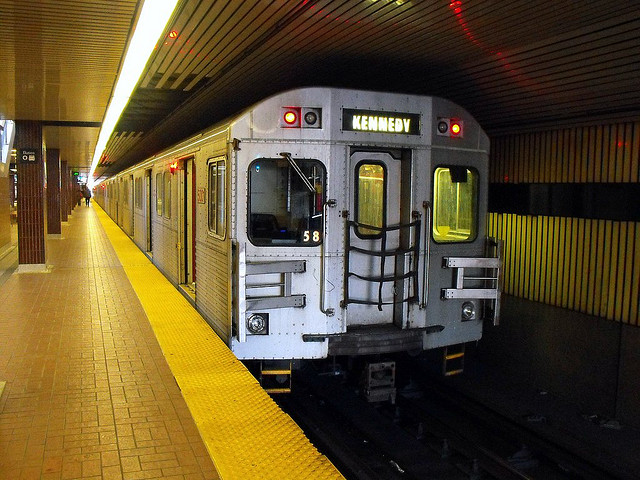

## Artificial Intelligence for Data Analysis {#workshop-title .workshop-bookend .workshop-cover}

```{=html}
<svg class="cover-sky" viewBox="0 0 1280 620" aria-hidden="true">
  <g class="cover-drifter cover-drifter-title" style="--drift-time:32s;--drift-delay:-0.0s;--drift-start:0%"><path class="cover-sky-triangle" d="M0 -11 L10 7 L-10 7 Z"/></g>
  <g class="cover-drifter cover-drifter-title" style="--drift-time:32s;--drift-delay:-6.4s;--drift-start:20%"><circle r="6"/></g>
  <g class="cover-drifter cover-drifter-title" style="--drift-time:32s;--drift-delay:-12.8s;--drift-start:40%"><rect x="-6" y="-6" width="12" height="12" rx="2" transform="rotate(25)"/></g>
  <g class="cover-drifter cover-drifter-title" style="--drift-time:32s;--drift-delay:-19.2s;--drift-start:60%"><circle r="8"/><ellipse rx="17" ry="5" transform="rotate(-25)"/></g>
  <g class="cover-drifter cover-drifter-title" style="--drift-time:32s;--drift-delay:-25.6s;--drift-start:80%"><path class="cover-sky-diamond" d="M0 -10 L7 0 L0 10 L-7 0 Z"/></g>
  <g class="cover-drifter cover-drifter-contact" style="--drift-time:27s;--drift-delay:-0.0s;--drift-start:0%"><path class="cover-sky-triangle" d="M0 -11 L10 7 L-10 7 Z"/></g>
  <g class="cover-drifter cover-drifter-contact" style="--drift-time:27s;--drift-delay:-5.4s;--drift-start:20%"><circle r="6"/></g>
  <g class="cover-drifter cover-drifter-contact" style="--drift-time:27s;--drift-delay:-10.8s;--drift-start:40%"><rect x="-6" y="-6" width="12" height="12" rx="2" transform="rotate(25)"/></g>
  <g class="cover-drifter cover-drifter-contact" style="--drift-time:27s;--drift-delay:-16.2s;--drift-start:60%"><circle r="8"/><ellipse rx="17" ry="5" transform="rotate(-25)"/></g>
  <g class="cover-drifter cover-drifter-contact" style="--drift-time:27s;--drift-delay:-21.6s;--drift-start:80%"><path class="cover-sky-diamond" d="M0 -10 L7 0 L0 10 L-7 0 Z"/></g>
  <g transform="translate(130 35)"><g class="cover-floater" style="--float-time:10s;--float-delay:-0s"><path class="cover-sky-triangle" d="M0 -11 L10 7 L-10 7 Z"/></g></g>
  <g transform="translate(520 38)"><g class="cover-floater" style="--float-time:11s;--float-delay:-2s"><circle r="6"/></g></g>
  <g transform="translate(625 550)"><g class="cover-floater" style="--float-time:12s;--float-delay:-4s"><rect x="-6" y="-6" width="12" height="12" rx="2" transform="rotate(25)"/></g></g>
  <g transform="translate(205 595)"><g class="cover-floater" style="--float-time:13s;--float-delay:-6s"><circle r="8"/><ellipse rx="17" ry="5" transform="rotate(-25)"/></g></g>
  <g transform="translate(42 565)"><g class="cover-floater" style="--float-time:14s;--float-delay:-8s"><path class="cover-sky-diamond" d="M0 -10 L7 0 L0 10 L-7 0 Z"/></g></g>
  <g transform="translate(550 600)"><g class="cover-floater" style="--float-time:15s;--float-delay:-10s"><path class="cover-sky-triangle" d="M0 -11 L10 7 L-10 7 Z"/></g></g>
  <g transform="translate(665 100)"><g class="cover-floater" style="--float-time:16s;--float-delay:-12s"><circle r="6"/></g></g>
  <g transform="translate(1210 575)"><g class="cover-floater" style="--float-time:17s;--float-delay:-14s"><rect x="-6" y="-6" width="12" height="12" rx="2" transform="rotate(25)"/></g></g>
</svg>
<div class="workshop-contact"><p class="workshop-author">Andre A. Cire</p><p class="workshop-email"><a href="mailto:andre.cire@rotman.utoronto.ca">andre.cire@rotman.utoronto.ca</a></p></div>
<div class="workshop-event"><p>Management Technology Association Workshop</p><p class="workshop-date">November 2026</p></div>
<figure class="cover-cycle" aria-label="A continuous cycle connecting data, AI, insights, and technology">
<svg viewBox="0 0 520 520" role="img" aria-labelledby="cover-cycle-title cover-cycle-desc">
  <title id="cover-cycle-title">Explore, learn, and refine</title>
  <desc id="cover-cycle-desc">A moving signal travels clockwise between four connected ideas: data, AI, insights, and technology. Each stage lights up in turn.</desc>
  <defs><radialGradient id="cover-glow"><stop offset="0" stop-color="#e6f1ee" stop-opacity=".8"/><stop offset="1" stop-color="#f7fafb" stop-opacity="0"/></radialGradient><linearGradient id="cover-ring-color" x1="0" y1="0" x2="1" y2="1"><stop stop-color="#267f77"/><stop offset=".55" stop-color="#93bfb8"/><stop offset="1" stop-color="#c67d42"/></linearGradient></defs>
  <circle cx="260" cy="250" r="244" fill="url(#cover-glow)" class="cover-glow"/>
  <circle cx="260" cy="250" r="224" class="cover-outer-ring"/>
  <g class="cover-satellite-orbit"><g transform="translate(484 250)"><ellipse rx="16" ry="5" transform="rotate(-25)" class="cover-planet-ring"/><circle r="8" class="cover-planet"/></g><path d="M248 24 L258 42 L238 42 Z" class="cover-orbit-triangle"/></g>
  <g class="cover-satellite-orbit secondary"><circle cx="260" cy="26" r="6" class="cover-small-planet"/><path d="M30 247 L45 255 L31 264 Z" class="cover-orbit-triangle"/></g>
  <circle cx="260" cy="250" r="127" class="cover-inner-ring"/>
  <circle cx="260" cy="250" r="170" class="cover-main-ring"/>
  <g class="cover-orbit"><circle cx="260" cy="250" r="170" class="cover-signal-trail"/><circle cx="260" cy="80" r="7" class="cover-signal"/><circle cx="260" cy="80" r="13" class="cover-signal-halo"/></g>
  <text x="260" y="244" text-anchor="middle" class="cover-cycle-center">Explore</text>
  <text x="260" y="274" text-anchor="middle" class="cover-cycle-subtitle">Learn · refine</text>
  <g class="cover-cycle-step" style="--phase:0s" transform="translate(260 80)"><circle r="34" class="cover-node"/><g class="cover-icon"><rect x="-19" y="-18" width="38" height="36" rx="4"/><path d="M-19 -6 H19 M-19 6 H19 M-6 -18 V18"/><path class="cover-icon-accent" d="M1 -12 H11 M1 0 H11 M1 12 H11"/></g><text x="0" y="-50" text-anchor="middle" class="cover-cycle-label">Data</text></g>
  <g class="cover-cycle-step" style="--phase:3s" transform="translate(430 250)"><circle r="34" class="cover-node"/><rect class="cover-ai-box" x="-20" y="-17" width="40" height="34" rx="8"/><text x="0" y="8" text-anchor="middle" class="cover-ai-text">AI</text><path class="cover-ai-spark" d="M23 -29 V-17 M17 -23 H29"/><text x="0" y="59" text-anchor="middle" class="cover-cycle-label">AI</text></g>
  <g class="cover-cycle-step" style="--phase:6s" transform="translate(260 420)"><circle r="34" class="cover-node"/><g class="cover-icon"><path d="M-8 11 V5 C-24 -7 -14 -24 0 -24 C14 -24 24 -7 8 5 V11 Z M-8 17 H8 M-5 23 H5"/><path class="cover-icon-accent" d="M-23 -22 L-29 -28 M23 -22 L29 -28 M-26 -7 H-32 M26 -7 H32"/></g><text x="-12" y="57" text-anchor="middle" class="cover-cycle-label">Insights</text></g>
  <g class="cover-cycle-step" style="--phase:9s" transform="translate(90 250)"><circle r="34" class="cover-node"/><g class="cover-icon"><rect x="-17" y="-17" width="34" height="34" rx="4"/><rect x="-8" y="-8" width="16" height="16" rx="2" class="cover-icon-accent"/><path d="M-10 -17 V-25 M0 -17 V-25 M10 -17 V-25 M-10 17 V25 M0 17 V25 M10 17 V25 M-17 -10 H-25 M-17 0 H-25 M-17 10 H-25 M17 -10 H25 M17 0 H25 M17 10 H25"/></g><text x="-6" y="59" text-anchor="middle" class="cover-cycle-label">Technology</text></g>
</svg>
</figure>
```

::: {.notes}
Welcome students to the workshop. Introduce the TTC case and the goal of using AI to explore data, make predictions, and explain decisions. Name and contact address follow the supplied reference deck. The continuous loop connects data, AI, insights, and technology as a conceptual illustration of iteration, not a literal processing architecture. A signal travels around the enlarged four-stage ring while stages activate in sequence. Small planets orbit outside it, and triangles, planets, diamonds, and squares travel around the title and contact details and drift through the surrounding whitespace. Motion runs only while the title slide is visible; reduced-motion preferences show the static diagram.
:::

## We start with a problem {#problem}

```{=html}
<div class="problem-layout">
  <figure class="station-photo fragment" data-fragment-index="0">
    
    <figcaption>Kipling station, 2009. <a href="https://commons.wikimedia.org/wiki/File:Kipling_TTC_end_of_the_line.jpg">Buddahbless</a>, <a href="https://creativecommons.org/licenses/by/2.0/">CC BY 2.0</a>. Cropped.</figcaption>
  </figure>
  <div class="problem-copy">
    <p class="lead-statement fragment" data-fragment-index="1">Subway delays leave<br>passengers needing help.</p>
    <ul class="support-needs">
      <li class="support-example fragment" data-fragment-index="2">
        <span>Crowded platforms.</span>
        <svg class="support-illustration crowd-scene" viewBox="0 0 120 48" aria-hidden="true" focusable="false">
          <defs><g id="crowd-person-icon"><circle cy="-9" r="2.8"/><path d="M0-4 V3 M-4 1 V-2 Q0-6 4-2 V1 M0 3-3 9 M0 3 3 9"/></g></defs>
          <path class="platform-edge" d="M6 45 H114"/>
          <g class="crowd-back">
            <use class="crowd-person" href="#crowd-person-icon" x="18" y="15" style="--arrival:0s"/>
            <use class="crowd-person" href="#crowd-person-icon" x="35" y="15" style="--arrival:.12s"/>
            <use class="crowd-person" href="#crowd-person-icon" x="52" y="15" style="--arrival:.24s"/>
            <use class="crowd-person" href="#crowd-person-icon" x="69" y="15" style="--arrival:.36s"/>
            <use class="crowd-person" href="#crowd-person-icon" x="86" y="15" style="--arrival:.48s"/>
            <use class="crowd-person" href="#crowd-person-icon" x="103" y="15" style="--arrival:.60s"/>
          </g>
          <g class="crowd-front">
            <use class="crowd-person" href="#crowd-person-icon" x="10" y="33" style="--arrival:.06s"/>
            <use class="crowd-person" href="#crowd-person-icon" x="27" y="33" style="--arrival:.18s"/>
            <use class="crowd-person" href="#crowd-person-icon" x="44" y="33" style="--arrival:.30s"/>
            <use class="crowd-person" href="#crowd-person-icon" x="61" y="33" style="--arrival:.42s"/>
            <use class="crowd-person" href="#crowd-person-icon" x="78" y="33" style="--arrival:.54s"/>
            <use class="crowd-person" href="#crowd-person-icon" x="95" y="33" style="--arrival:.66s"/>
            <use class="crowd-person" href="#crowd-person-icon" x="112" y="33" style="--arrival:.78s"/>
          </g>
        </svg>
      </li>
      <li class="support-example fragment" data-fragment-index="3">
        <span>Door problems.</span>
        <svg class="support-illustration doors-scene" viewBox="0 0 120 48" aria-hidden="true" focusable="false">
          <rect class="door-frame" x="25" y="4" width="70" height="40" rx="3"/>
          <g class="door-panel door-left"><rect x="28" y="7" width="23" height="34" rx="2"/><path d="M45 22 V28"/></g>
          <g class="door-panel door-right"><rect x="69" y="7" width="23" height="34" rx="2"/><path d="M75 22 V28"/></g>
          <path class="door-obstruction" d="m60 26 5 7-5 7-5-7Z"/>
        </svg>
      </li>
      <li class="support-example fragment" data-fragment-index="4">
        <span>Weather disruptions.</span>
        <svg class="support-illustration weather-scene" viewBox="0 0 120 48" aria-hidden="true" focusable="false">
          <path class="weather-cloud" d="M39 25 C25 25 27 10 40 12 C43-1 64 0 68 12 C82 6 96 25 79 25 Z"/>
          <g class="weather-rain"><path d="m43 31-3 7"/><path d="m59 31-3 7"/><path d="m75 31-3 7"/></g>
        </svg>
      </li>
    </ul>
    <div class="fragment" data-fragment-index="4">
      <a class="source-link" href="https://open.toronto.ca/dataset/ttc-subway-delay-data/">Door and weather examples: TTC delay records</a>
    </div>
  </div>
</div>
<p class="takeaway fragment" data-fragment-index="5"><span class="question-focus">Where</span> and <span class="question-focus">when</span> should extra support go?</p>
```

::: {.notes}
Start with only the title and standard footer visible. Ask whether anyone has experienced a TTC disruption. Keep this discussion brief. Click 1 reveals the photograph; click 2 reveals the passenger-help statement. Clicks 3, 4 and 5 reveal crowded platforms, door problems, and weather disruptions, respectively. Each has a short stylistic animation: people appearing to form a crowd, doors meeting an obstruction and reopening, and rain beneath a cloud. Click 6 reveals the deployment question. Each build waits for the presenter; illustrations are not reconstructions of individual incidents.

This is a fictional passenger-support pilot using real TTC records. Extra teams help with directions, information and alternatives. We are not estimating that their presence prevents a delay.

“Crowded platforms” is an illustrative passenger situation that may follow a delay, not a recorded delay reason in the prepared dataset. The crowd is a stylistic illustration, not a measured passenger count. The source caption applies only to the door and weather examples, which summarize actual code descriptions in ../ttc_case/data/training_log_entries.csv (708 positive-delay entries). “Door problems” covers MUDD (debris related, 21), EUDO (faulty equipment, 14), and MUD (passenger related, 5); the obstruction animation illustrates the debris-related category. “Weather disruptions” summarizes MUWEA (weather reports / related problems, 49); rain is a generic illustration, since that code does not specify the weather type. These are examples, not a ranking of causes. Source: City of Toronto, TTC Subway Delay Data, https://open.toronto.ca/dataset/ttc-subway-delay-data/ . Counts refer to the prepared training extract, not the full TTC network or independent incidents.

Photograph: Buddahbless, TTC Kipling subway station, 14 April 2009, via Wikimedia Commons. https://commons.wikimedia.org/wiki/File:Kipling_TTC_end_of_the_line.jpg . CC BY 2.0, https://creativecommons.org/licenses/by/2.0/ . Original file retained locally; display crop only. This is a location photograph, not a photograph of an observed delay in our dataset.
:::

## Our goal today {#goal}

```{=html}
<div class="goal-layout">
  <div class="goal-copy">
    <p class="role-line fragment" data-fragment-index="0">TTC hired you to <strong>assign support teams</strong> to stations.</p>
    <p class="objective fragment" data-fragment-index="1">Place teams where and when they maximize the number of passengers helped.</p>
    <dl class="constraints">
      <div class="fragment" data-fragment-index="2"><dt>Your decision</dt><dd><strong>3</strong> station–time pairs</dd></div>
      <div class="fragment" data-fragment-index="3"><dt>Duration</dt><dd><strong>2 hours</strong> per time window</dd></div>
    </dl>
    <div class="passenger-summary fragment" data-fragment-index="4" aria-live="polite" aria-atomic="true">
      <p class="passenger-label">Expected passengers needing help</p>
      <p class="passenger-value" id="passenger-count">0</p>
      <p class="passenger-caption">Total across your selections · Illustrative estimates</p>
    </div>
    <div class="decision-stages fragment" data-fragment-index="6">
      <div><span class="stage-label">Prediction</span><p>How many passengers may need help?</p></div>
      <div class="fragment" data-fragment-index="7"><span class="stage-label">Optimization</span><p>Which three pairs should we choose?</p></div>
    </div>
  </div>
  <div class="allocation-demo fragment" data-fragment-index="5">
    <div class="allocation-heading"><span><strong>15 stations</strong> · Example time windows</span><button class="text-button" id="reset-allocation" type="button">Reset</button></div>
    <table class="allocation-table" aria-label="Choose three station and time pairs. Select a cell to update the expected passenger total on the left.">
      <thead><tr><th scope="col">Station</th><th scope="col">07–09</th><th scope="col">12–14</th><th scope="col">16–18</th></tr></thead>
      <tbody id="allocation-rows"></tbody>
    </table>
    <div class="allocation-status" aria-live="polite"><span id="selection-count">0 / 3 pairs selected</span></div>
    <p class="interaction-note" id="allocation-message">Select a cell. See the expected passengers on the left.</p>
  </div>
</div>
```

::: {.notes}
In this fictional pilot, TTC has hired the students to assign passenger-support teams. Their goal is to choose three station–time pairs that maximize the total expected passengers needing help at those locations and times. Assign one support team to each chosen pair. The 15 stations and three example two-hour windows give 45 candidate pairs. A station may be selected in more than one window. Team sizes and staffing budgets are outside this simplified case.

Click a cell to select or deselect a pair. The left-hand total sums the expected passengers needing help at the selected station–time pairs. Up to three selections are allowed. Reset clears both the selection and total. Treat the additive total as passenger journeys at the selected locations and times, not deduplicated individual people. Students can compare alternatives by swapping a pair.

Passenger estimates are fixed, artificial examples for explaining the decision and live in assets/workshop-data.js. They are not measured ridership or fitted predictions from the TTC delay logs. Those logs contain delay events, not passenger counts. Actual passenger estimates would require an additional passenger-volume source or an explicitly assumed conversion from predicted disruptions. For the later data exercise, a directly supported target is the probability of a recorded delay. The display's “Illustrative estimates” caption makes the distinction visible without a teaching-assumptions line.

Start with the title and footer. Reveal, one click at a time: TTC's assignment, objective, three-pair choice, time-window duration, expected-passenger display, selection grid, prediction, and optimization. The passenger display is visible before the grid becomes interactive. Each click within the grid changes a selection without advancing the slide.
:::

## Data {#data}

```{=html}
<p class="lede data-intro fragment" data-fragment-index="0">When TTC records a subway delay, it logs the <strong>time, station, reported issue, and delay duration.</strong></p>
<div class="data-layout">
  <div class="data-example">
    <p class="log-label fragment" data-fragment-index="1">One row = one recorded delay entry</p>
    <div id="log-view" class="fragment" data-fragment-index="2"><table class="data-table" aria-label="Three real positive-delay log entries"><thead><tr><th>Date</th><th>Time</th><th>Station</th><th>Reported issue</th><th>Delay (min)</th></tr></thead><tbody id="log-rows"></tbody></table></div>
    <p class="data-caption fragment" data-fragment-index="2">....</p>
    <a class="source-link fragment" data-fragment-index="2" href="https://open.toronto.ca/dataset/ttc-subway-delay-data/">Source: City of Toronto Open Data</a>
  </div>
  <div class="data-summary">
    <div class="fragment" data-fragment-index="4">
      <p class="big-number" id="data-count">708</p>
      <p class="metric-description" id="data-unit">positive-delay log entries</p>
    </div>
    <p class="period fragment" data-fragment-index="4">15 stations · Weekdays<br>January–September 2025</p>
    <div class="csv-download fragment" data-fragment-index="5">
      <a class="action-button" id="download-csv" href="assets/data/ttc_training_log_jan_sep_2025.csv" download="ttc_training_log_jan_sep_2025.csv" aria-describedby="download-status">Download CSV</a>
      <p id="download-status">January–September 2025</p>
    </div>
  </div>
</div>
<div class="data-purpose fragment" data-fragment-index="6">
  <p>Turn evidence into <strong>actions.</strong></p>
  <span class="fragment" data-fragment-index="7">AI will help us inspect the data, make predictions, and compare decisions.</span>
</div>
```

::: {.notes}
Introduce the data as TTC's record of subway delays. Each displayed row provides the date, time, station, reported issue (the description associated with the TTC delay code), and delay duration in minutes. Walk through the first row: 1 January 2025, 08:13, Bloor-Yonge, a rail-related problem, nine delay minutes. The table shows the first three real entries from the prepared CSV.

Start with the title and footer only. Reveal on successive clicks: the introduction, row definition, sample table together with its source link, caption, record count together with the station/date coverage, CSV download, “Turn evidence into actions,” and the AI explanation. Keep the table's rows together so students can read them as one example.

The prepared log has 708 rows after removing 1,074 zero-minute log entries. It covers the 15 selected stations, weekdays in January–September 2025, and the three selected time windows. Several rows can describe related events, so describe these as recorded entries rather than a count of independent incidents. The extract does not establish that all disruptions were recorded.

Use the January–September dataset on this opening slide; reserve the testing-set download for Slide 19 and do not add a prediction-table view here. Discuss model training at the end of the workshop. This slide explains what the records contain. The Download CSV link provides the January–September training log, with a relative file URL online and an embedded download when opened offline.

Sources: ../ttc_case/data/training_log_entries.csv and ../ttc_case/README.md. Official source: https://open.toronto.ca/dataset/ttc-subway-delay-data/ . Contains information licensed under the Open Government Licence - Toronto. AI-assisted analysis should produce inspectable tables, calculations and code.
:::

## Leveraging AI tools {#llm}

```{=html}
<p class="lede fragment" data-fragment-index="0">To use them effectively, we need to understand how they work.</p>
<p class="llm-intuition fragment" data-fragment-index="1"><strong>Intuition:</strong> predict the next token based on all information so far, and pick the most likely next one.</p>
<div class="token-demo" aria-label="An illustrative diagram of next-token generation">
  <div class="context-stage fragment" data-fragment-index="2"><span class="diagram-label">Text so far</span><div class="context-text" id="token-context" aria-live="polite">The next train arrives in</div><span class="token-definition">A token is a word or part of a word.</span></div>
  <div class="diagram-arrow fragment" data-fragment-index="3" aria-hidden="true"></div>
  <div class="model-stage fragment" data-fragment-index="3"><div class="model-symbol"><svg id="llm-network" viewBox="0 0 200 124" role="img" aria-label="Illustrative neural network: activation moves from left to right through colored nodes"></svg></div><span>Patterns learned<br>from training data</span></div>
  <div class="diagram-arrow prediction-arrow fragment" data-fragment-index="3" aria-hidden="true"></div>
  <div class="prediction-stage fragment" data-fragment-index="3"><span class="diagram-label" id="token-heading">Possible next tokens</span><div id="token-options"></div><span class="token-disclosure">Illustrative probabilities</span></div>
</div>
<div class="token-controls fragment" data-fragment-index="4"><button type="button" class="action-button" id="generate-token">Generate next token</button><button type="button" class="text-button" id="reset-tokens">Reset</button><span id="token-status" aria-live="polite">Try completing the sentence.</span></div>
<div class="model-families fragment" data-fragment-index="5">
  <div><span class="diagram-label">Frontier model families</span><p><a href="https://developers.openai.com/api/docs/models/all">GPT</a><span class="family-separator"> / </span><a href="https://platform.claude.com/docs/en/models/overview">Claude</a></p><span>Advanced general-purpose capabilities</span></div>
  <div class="fragment" data-fragment-index="6"><span class="diagram-label">Open-weight examples</span><p><a href="https://qwen.readthedocs.io/en/stable/getting_started/concepts.html">Qwen</a><span class="family-separator"> / </span><a href="https://developers.openai.com/api/docs/models/all">gpt-oss</a></p><span>Downloadable weights, subject to a licence</span></div>
  <p class="family-note fragment" data-fragment-index="7">Each model has their own capabilities and features.</p>
</div>
```

::: {.notes}
Introduce LLM as “large language model.” Use Generate next token to append five, then minutes, then a period. The candidates and probabilities are fixed teaching illustrations, not a live model call or measured probabilities. We use word-sized chunks to keep the diagram readable; actual token boundaries depend on the tokenizer. The reset button restores the starting context. The model predicts a conditional distribution over tokens, and a decoding procedure chooses a continuation. The intuition statement and this demonstration simplify that choice to the highest-probability option; real systems can sample other tokens. “All information so far” means the context available to the model. Generated text does not establish a real train arrival time. The displayed text is a demonstration, not an editable input, and has no typing cursor.

Start with only the title and footer. Reveal on separate clicks: the introduction, intuition, text so far and token definition, LLM and incoming arrow, generation controls, frontier model examples, open-weight examples, and the capability/openness note. On the first LLM reveal, the activation animation automatically adds “five” to the text when it finishes, and shows the options that produced that token: “five”, “two”, and “ten”, alongside the outgoing arrow. Keep this table visible until the next Generate action. No Generate click is needed for this first token. Revealing the network again preserves any tokens already generated. Each Generate click hides the previous predictions, plays the activation, then adds the chosen token and reveals the options from that same generation step. The next click adds “minutes” and shows “minutes”, “seconds”, and “hours”; the final click adds the period and shows punctuation options. Pause at the controls to demonstrate token generation before advancing to the model examples. Generate and Reset do not advance the slide.

The diagram describes autoregressive text generation, not the whole architecture of an AI assistant. Training, post-training, reasoning and tool use add important capabilities. In this workshop we use assistants that can also execute code and inspect files.

The colored neural network is a schematic illustration, not a literal transformer architecture or measured model activations. A short activation pulse travels left to right when the model is revealed and whenever Generate next token is clicked. Reset stops the pulse. Reduced-motion settings show the static network.

Frontier refers to advanced capabilities. Open-weight refers to access to trained parameters under licence terms. These are separate dimensions; an open-weight model can also have frontier capabilities. Model-family examples are illustrative and not a ranking. Version numbers are deliberately omitted. GPT and Claude include a range of model sizes; Qwen includes both proprietary and open-weight versions.

Sources checked 7 November 2026: Qwen Key Concepts, https://qwen.readthedocs.io/en/stable/getting_started/concepts.html (autoregressive generation, training, and open/proprietary versions); OpenAI model catalogue, https://developers.openai.com/api/docs/models/all (GPT and gpt-oss); Claude models overview, https://platform.claude.com/docs/en/models/overview . Tokenizer explanation: https://platform.openai.com/tokenizer .
:::

## Should we just “one-shot”? {#one-shot}

```{=html}
<p class="lede">That is, simply upload the data and ask for the final recommendation in one prompt.</p>
<div class="comparison-panel">
  <table class="comparison-table" aria-label="Trade-offs between a single prompt and a step-by-step process with AI">
    <thead><tr><th></th><th>One shot is best when...</th><th>Step by step is best when...</th></tr></thead>
    <tbody>
      <tr class="fragment" data-fragment-index="0"><th scope="row">Risk</th><td class="fragment" data-fragment-index="1">Low stakes, easy to check</td><td class="fragment" data-fragment-index="1">Consequences call for explicit checks</td></tr>
      <tr class="fragment" data-fragment-index="2"><th scope="row">Differentiation</th><td class="fragment" data-fragment-index="3">A standard, common answer is enough</td><td class="fragment" data-fragment-index="3">Your framing and assumptions add value</td></tr>
      <tr class="fragment" data-fragment-index="4"><th scope="row">Complexity</th><td class="fragment" data-fragment-index="5">Simple and short</td><td class="fragment" data-fragment-index="5">Answers are long, multi-layered</td></tr>
      <tr class="fragment" data-fragment-index="6"><th scope="row">Understanding</th><td class="fragment" data-fragment-index="7">Only high-level or none is enough</td><td class="fragment" data-fragment-index="7">Understand choices and intermediate results</td></tr>
      <tr class="fragment" data-fragment-index="8"><th scope="row">Effort</th><td class="fragment" data-fragment-index="9">Small (for instance, a fast starting point)</td><td class="fragment" data-fragment-index="9">More interaction and judgement</td></tr>
    </tbody>
  </table>
  <p class="process-note fragment" data-fragment-index="10">Principle: choose option based on your objective, assumptions, and checks.<br><strong>AI can support you either situations.</strong></p>
</div>
<div class="exercise-panel" aria-hidden="true" inert>
  <p class="exercise-title">Exercise: which approach would you choose in each case?</p>
  <div class="exercise-grid">
    <article class="exercise" data-case="invitation">
      <span class="exercise-number">01</span><h3>Summarize an event invitation</h3><p>You can check the date, location, and details.</p>
      <div class="exercise-buttons"><button type="button" data-choice="one">One prompt</button><button type="button" data-choice="process">Step by step</button></div>
      <p class="exercise-feedback" aria-live="polite"></p>
    </article>
    <article class="exercise" data-case="ttc">
      <span class="exercise-number">02</span><h3>Choose TTC stations and times</h3><p>Three choices. Uncertain delays. Compare expected passenger needs.</p>
      <div class="exercise-buttons"><button type="button" data-choice="one">One prompt</button><button type="button" data-choice="process">Step by step</button></div>
      <p class="exercise-feedback" aria-live="polite"></p>
    </article>
    <article class="exercise" data-case="competition">
      <span class="exercise-number">03</span><h3>Enter an analytics competition</h3><p>Other teams have access to comparable AI models.</p>
      <div class="exercise-buttons"><button type="button" data-choice="one">One prompt</button><button type="button" data-choice="process">Step by step</button></div>
      <p class="exercise-feedback" aria-live="polite"></p>
    </article>
  </div>
  <button type="button" class="text-button" id="back-to-comparison">Back to the comparison</button>
</div>
<span class="fragment step-marker" data-fragment-index="11" aria-hidden="true"></span>
```

::: {.notes}
Here, one-shot is our informal name for asking for the final result in one prompt. In machine-learning terminology, one-shot prompting can instead mean providing one example. State our intended meaning so students do not confuse the two.

The table gives teaching heuristics, not guaranteed differences in model quality. A single request can ask an assistant to run a sophisticated workflow. Our distinction is whether the student inspects intermediate assumptions, evidence, calculations and choices. Either approach still requires verification appropriate to the task.

For differentiation, discuss what students contribute when competitors use comparable models: a better objective, useful features, sensible assumptions, out-of-sample testing and a clear explanation. Step-by-step work involves abstraction: moving between the business objective, the data representation, the prediction target and the selection rule. Repeating questions alone does not guarantee added value.

Build the table cumulatively, using two clicks per row. First reveal only the dimension label, ask students to compare the approaches, then click to reveal both column values together. Continue through Risk, Differentiation, Complexity, Understanding, and Effort, keeping earlier rows visible. The next click reveals the closing note, then one more opens the discussion examples. Let students defend a choice before clicking an answer. Back to the comparison restores the complete table and closing note; backward navigation reverses each reveal.
:::

## Data analysis process {#analysis-process}

```{=html}
<div class="process-flow">
  <article class="process-step fragment" data-fragment-index="0">
    <span class="process-number">01</span>
    <svg class="process-icon read-icon" viewBox="0 0 240 140" aria-hidden="true">
      <rect class="icon-paper" x="38" y="18" width="164" height="104" rx="7"/>
      <path class="icon-grid" d="M38 44 H202 M38 70 H202 M38 96 H202 M88 18 V122 M146 18 V122"/>
      <rect class="scan-row" x="40" y="46" width="160" height="22" rx="3"/>
      <path class="scan-tick" pathLength="1" d="m160 59 7 7 17-17"/>
    </svg>
    <h3>Understand the data</h3>
    <p>What does each row mean?</p>
  </article>
  <span class="process-connector fragment" data-fragment-index="1" aria-hidden="true">→</span>
  <article class="process-step fragment" data-fragment-index="1">
    <span class="process-number">02</span>
    <svg class="process-icon pattern-icon" viewBox="0 0 240 140" aria-hidden="true">
      <path class="icon-grid" d="M35 20 V119 H210"/>
      <rect class="pattern-bar" x="55" y="74" width="27" height="43"/>
      <rect class="pattern-bar" x="99" y="49" width="27" height="68" style="--bar-delay:.12s"/>
      <rect class="pattern-bar" x="143" y="26" width="27" height="91" style="--bar-delay:.24s"/>
      <path class="pattern-trend" pathLength="1" d="M62 62 111 38 157 15"/>
    </svg>
    <h3>Identify patterns</h3>
    <p>What changes by station or time?</p>
  </article>
  <span class="process-connector fragment" data-fragment-index="2" aria-hidden="true">→</span>
  <article class="process-step fragment" data-fragment-index="2">
    <span class="process-number">03</span>
    <svg class="process-icon forecast-icon" viewBox="0 0 240 140" aria-hidden="true">
      <path class="icon-grid" d="M28 20 V119 H216"/>
      <path class="history-line" d="M43 98 70 84 96 92 124 64 150 71"/>
      <path class="forecast-band" d="M150 71 205 25 V83 Z"/>
      <path class="forecast-line" pathLength="1" d="M150 71 205 51"/>
      <circle class="forecast-point" cx="205" cy="51" r="6"/>
    </svg>
    <h3>Make predictions</h3>
    <p>What might happen next?</p>
  </article>
</div>
<div class="process-foundation fragment" data-fragment-index="3">
  <p>
  Fundamental principal:
  <strong>Visualize</strong> what you find and <strong>explain</strong> what it means.
  </p>
  <span>Visualization and interpretability matter at every step.</span>
</div>
```

::: {.notes}
Reveal the three steps one at a time, then the principle underneath. Each icon plays a short animation when its step appears: a highlighted data row, growing bars, and a projected continuation. These are schematic illustrations, not TTC measurements or fitted forecasts. The shaded prediction band represents uncertainty conceptually, not a computed interval.

Connect the process to the case. First establish what the TTC log records. Then compare delay counts and durations across stations and times. Finally use the available information to make predictions that inform the station–time choice. Keep model-training details for the end of the workshop. Visualization makes patterns visible; interpretability means students can explain the result, its units, and the assumptions behind it.
:::

## Understand the data {#understand-data data-transition-speed="slow"}

```{=html}
<div class="understand-layout">
  <div class="reading-steps">
    <article class="reading-step fragment" data-fragment-index="0">
      <span class="process-number">01</span><h3>Read rows and columns</h3>
      <p>Explain one entry in plain language.</p>
    </article>
    <article class="reading-step fragment" data-fragment-index="1">
      <span class="process-number">02</span><h3>Check units and counts</h3>
      <p>Minutes measure delay.<br>Rows count recorded entries.</p>
    </article>
    <article class="reading-step fragment" data-fragment-index="2">
      <span class="process-number">03</span><h3>Look for errors</h3>
      <p>Check missing values, repeated entries,<br>and unexpected values.</p>
    </article>
  </div>
  <div class="reading-example fragment" data-fragment-index="0">
    <div class="reading-record">
    <p class="log-label">Read a real TTC entry</p>
    <table class="reading-table" aria-label="Three real TTC entries with units">
      <thead><tr><th>Date / time</th><th>Station</th><th>Reported issue</th><th>Delay<br>(min)</th></tr></thead>
      <tbody id="reading-rows"></tbody>
    </table>
    <p class="entry-explanation">At 08:13, a rail-related problem at Bloor-Yonge was logged with a 9-minute delay.</p>
    </div>
    <div class="unit-reminder fragment" data-fragment-index="1"><strong>708 entries</strong><span>across 15 stations</span><span>Passenger counts require another source.</span></div>
    <div class="audit-summary fragment" data-fragment-index="2">
      <span class="diagram-label">A quick check of this extract</span>
      <div class="audit-values"><span><strong id="audit-missing">0</strong> missing core values</span><span><strong id="audit-duplicates">0</strong> exact repeat rows</span></div>
      <p id="audit-range"></p>
    </div>
  </div>
</div>
```

::: {.notes}
On the first click, show the reading step and the actual sample entries. Match each left-hand step's light fill to its corresponding information on the right: blue-grey for the sample entry, warm cream for units and counts, and pale green for the error checks. Retain these fills as later steps appear. Ask a student to explain the outlined row. On the second click, highlight the delay-minutes column and distinguish units: a row is a recorded log entry, Min Delay is minutes, and station is a category. Multiple rows can refer to related events. The dataset does not contain passenger counts.

On the third click, reveal the cleaning checks. The counts are computed from the current CSV, not invented problems. “Missing core values” counts rows missing Date, Time, station, code_description, or Min Delay. “Exact repeat rows” counts extra copies with identical Date, Time, Station, Code, Min Delay, Min Gap, Bound, Line, and Vehicle; the record identifier is excluded. The displayed maximum duration is an observation to inspect, not proof of an error. Confirm context before changing or dropping unusual values. Zero-minute entries were removed earlier at the user's request; the original data remains available for audit.

Source: ../ttc_case/data/training_log_entries.csv. The three displayed records and audit summaries are generated by scripts/prepare_data.py. Keep the focus on reading and checking; model training will be discussed later.
:::

## Constructing a useful prompt {#prompt-structure}

```{=html}
<p class="lede fragment" data-fragment-index="0">A good prompt makes the task, contextual information, and expected answer clear. You design it based on four dimensions (and more as you become more advanced):</p>
<div class="prompt-ingredients">
  <div class="prompt-ingredient fragment" data-fragment-index="1"><span class="process-number">01</span><h3>Task</h3><p>What should AI do?</p><blockquote>Count the rows in the file.</blockquote></div>
  <div class="prompt-ingredient fragment" data-fragment-index="2"><span class="process-number">02</span><h3>Context</h3><p>What information should it use?</p><blockquote>Use the attached TTC delay CSV.</blockquote></div>
  <div class="prompt-ingredient fragment" data-fragment-index="3"><span class="process-number">03</span><h3>Output format</h3><p>What should the answer look like?</p><blockquote>Return the count in one sentence.</blockquote></div>
  <div class="prompt-ingredient fragment" data-fragment-index="4"><span class="process-number">04</span><h3>Checks</h3><p>What rules should it follow?</p><blockquote>Exclude the header. Count every data row.</blockquote></div>
</div>
<div class="prompt-guidance fragment" data-fragment-index="5"><p><strong>Always start simple, check the answer, and refine the prompt iteratively.</strong></p><span class="assembled-prompt">Example: <em>Count the rows in the file using the attached TTC delay CSV. Return the count in one sentence.</em></span><a class="source-link" href="https://developers.openai.com/api/docs/guides/prompt-engineering">Adapted from OpenAI’s prompting guidance</a></div>
```

::: {.notes}
A prompt is the instruction and information you give the AI assistant. Reveal each ingredient and its TTC example on a separate click. Read the assembled prompt underneath the ingredients. It combines the four parts as a natural paragraph without labels.

This four-part classroom template adapts OpenAI’s guidance on explicit instructions, relevant context, clear sections, and examples. “Checks” makes task-specific constraints explicit. There is no universally optimal prompt structure: adjust it to the question, model, and observed answer. An example is useful when a desired format is hard to describe, but it is optional for these simple counts. Students still need to verify the output against the file.

Source: https://developers.openai.com/api/docs/guides/prompt-engineering (accessed November 7, 2026).
:::

## Hands-on: understand the TTC data {#hands-on}

```{=html}
<p class="lede fragment" data-fragment-index="0">Let's see standard first prompt in data analysis!</p>
<div class="hands-on-workspace fragment" data-fragment-index="1">
  <div class="explore-tabs" role="group" aria-label="Choose a TTC data question">
    <button type="button" class="explore-tab" data-explore="columns" aria-pressed="true">What is each column?</button>
    <button type="button" class="explore-tab" data-explore="rows" aria-pressed="false">How many rows?</button>
    <button type="button" class="explore-tab" data-explore="stations" aria-pressed="false">How many stations?</button>
  </div>
  <div class="hands-on-prompt">
    <div class="prompt-example">
      <span class="diagram-label">Try asking GPT, Claude, or your favorite AI</span>
      <p id="analysis-prompt" aria-live="polite"></p>
      <button class="text-button" id="copy-analysis-prompt" type="button">Copy prompt</button>
      <span id="copy-prompt-status" role="status"></span>
    </div>

  </div>
  <a class="source-link" href="https://open.toronto.ca/dataset/ttc-subway-delay-data/">Source: TTC delay records · Prepared January–September 2025 extract</a>
</div>
<p class="hands-on-takeaway fragment" data-fragment-index="2">Be precise and <strong>take your time writing a prompt</strong>: the more information, the better context and outcomes.</p>
```

::: {.notes}
Ask students to download the training CSV from Slide 4 and attach it to their AI tool. These are copyable prompt examples, not live requests to GPT. Each prompt combines the ingredients from Slide 9 into natural prose, without labels. Prompts are italicized and occupy the full content area. Tabs update only the prompt without advancing the slide. Students produce the answers themselves; no results are shown. Copy prompt falls back to selecting the text if clipboard access is unavailable.

The column question asks for every column. Column names alone may not establish meaning, so students should identify uncertainty and consult documentation. The standardized lowercase station field combines interchange platforms and is the field used for distinct-station counts. The row count excludes the CSV header and includes all 708 prepared records. The distinct count is 15, computed from station in the same extract. These instructor reference counts come from scripts/prepare_data.py and remain in the notes only.

Keep this exercise to column meanings, rows, and distinct stations. Comparisons, charts, time-of-day patterns, and delay-duration questions belong in the later pattern-identification section.
:::

## Identifying patterns {#patterns}

```{=html}
<div class="pattern-cycle">
  <svg class="iteration-ring" viewBox="0 0 600 430" role="img" aria-label="Questions lead to analysis, analysis leads to insights, and insights lead to new questions in a continuous cycle.">
    <defs><marker id="cycle-arrowhead" markerWidth="10" markerHeight="10" refX="8" refY="5" orient="auto"><path d="M2 1 L8 5 L2 9"/></marker></defs>
    <g class="fragment ring-node cycle-question" data-fragment-index="0"><svg class="cycle-icon" x="260" y="40" width="80" height="50" viewBox="0 0 160 100" aria-hidden="true"><path d="M35 15 H125 Q139 15 139 29 V66 Q139 80 125 80 H70 L47 94 V80 H35 Q21 80 21 66 V29 Q21 15 35 15Z"/><path class="cycle-detail" d="M67 37 C67 20 96 20 96 37 C96 49 81 48 81 59"/><circle class="cycle-dot" cx="81" cy="69" r="2.5"/></svg><text class="ring-label" x="300" y="20">Questions</text></g>
    <g class="fragment" data-fragment-index="1"><path class="ring-arc" pathLength="1" d="M337 70 A155 155 0 0 1 452 262"/><g class="ring-node cycle-analysis"><svg class="cycle-icon" x="394" y="273" width="80" height="50" viewBox="0 0 160 100" aria-hidden="true"><path d="M24 15 V84 H143"/><rect class="cycle-bar" x="40" y="52" width="20" height="30"/><rect class="cycle-bar" x="76" y="35" width="20" height="47"/><rect class="cycle-bar" x="112" y="19" width="20" height="63"/><path class="cycle-detail" d="M33 44 H140" stroke-dasharray="5 5"/></svg><text class="ring-label" x="475" y="354">Analysis</text></g></g>
    <g class="fragment" data-fragment-index="2"><path class="ring-arc" pathLength="1" d="M407 329 A155 155 0 0 1 193 329"/><g class="ring-node cycle-insight"><svg class="cycle-icon" x="126" y="273" width="80" height="50" viewBox="0 0 160 100" aria-hidden="true"><path d="M64 73 V65 C38 44 51 13 80 13 C109 13 122 44 96 65 V73Z M65 82 H95 M71 91 H89"/><path class="cycle-detail" d="M80 73 V48 M68 38 L80 50 L92 38 M80 2 V6 M37 16 L45 23 M20 43 H32 M123 16 L115 23 M128 43 H140"/></svg><text class="ring-label" x="125" y="354">Insights</text></g></g>
    <g class="pattern-return fragment" data-fragment-index="3"><path class="ring-arc" pathLength="1" d="M148 262 A155 155 0 0 1 263 70"/><text class="ring-center" x="300" y="211">Ask. Learn.</text><text class="ring-center" x="300" y="244">Ask again.</text><circle class="cycle-signal return-signal" r="6"/></g>
  </svg>
  <div class="cycle-explanation">
  <article class="cycle-stage cycle-question fragment" data-fragment-index="0">
    
    <h3><svg class="cycle-icon" viewBox="0 0 160 100" aria-hidden="true"><path d="M35 15 H125 Q139 15 139 29 V66 Q139 80 125 80 H70 L47 94 V80 H35 Q21 80 21 66 V29 Q21 15 35 15Z"/><path class="cycle-detail" d="M67 37 C67 20 96 20 96 37 C96 49 81 48 81 59"/><circle class="cycle-dot" cx="81" cy="69" r="2.5"/></svg><span>Questions</span></h3>
    <p>Explore distributions and relationships across one or more columns.</p>
    <span class="cycle-caption">Each question becomes a prompt.</span>
  </article>
  <article class="cycle-stage cycle-analysis fragment" data-fragment-index="1">
    
    <h3><svg class="cycle-icon" viewBox="0 0 160 100" aria-hidden="true"><path d="M24 15 V84 H143"/><rect class="cycle-bar" x="40" y="52" width="20" height="30"/><rect class="cycle-bar" x="76" y="35" width="20" height="47"/><rect class="cycle-bar" x="112" y="19" width="20" height="63"/><path class="cycle-detail" d="M33 44 H140" stroke-dasharray="5 5"/></svg><span>Analysis</span></h3>
    <p>Use a plot or a statistic to answer the question.</p>
    <span class="cycle-caption">Mean · Standard deviation · Correlation</span>
  </article>
  <article class="cycle-stage cycle-insight fragment" data-fragment-index="2">
    
    <h3><svg class="cycle-icon" viewBox="0 0 160 100" aria-hidden="true"><path d="M64 73 V65 C38 44 51 13 80 13 C109 13 122 44 96 65 V73Z M65 82 H95 M71 91 H89"/><path class="cycle-detail" d="M80 73 V48 M68 38 L80 50 L92 38 M80 2 V6 M37 16 L45 23 M20 43 H32 M123 16 L115 23 M128 43 H140"/></svg><span>Insights</span></h3>
    <p>Explain what you learned and what deserves a closer look.</p>
    <span class="cycle-caption">What will you ask next?</span>
  </article>
  </div>
</div>

```

::: {.notes}
Introduce pattern identification as an iterative process. Click 1 reveals Questions, click 2 adds Analysis and its connecting arrow, click 3 adds Insights, and click 4 closes the loop back to Questions. Each connecting arrow draws toward its destination over 1.1 seconds when that destination is revealed; its arrowhead appears at the end. The final click draws the arrow back to Questions. Once that arrow finishes, a gentle repeating animation moves through the stages and follows the circular path. It stops when leaving the slide or reversing the final build. Reduced-motion settings retain a static diagram.

Questions can concern the distribution of a single column, such as delay duration, or relationships involving several columns, such as duration by station and time window. Each question becomes a prompt written in natural language. Analysis produces evidence: a plot, a mean, a standard deviation, or another suitable statistic. An insight explains what that evidence tells us and motivates the next question.

For a verbal TTC example: ask how recorded delay durations differ by time window, compare their distributions, then inspect whether an apparent difference also appears within individual stations. Do not claim a difference before computing it. These icons illustrate the process; they do not display measured TTC results.

Use correlation when it suits the variables and question. Station names and time-window labels are categories; arbitrarily coding them as numbers does not make a numeric correlation meaningful. Grouped summaries and plots can help examine those relationships. An observed association alone does not establish a cause. Keep the slide focused on the cycle; subsequent slides can introduce concrete prompts and computed results.
:::

## Example: delay minutes by station {#station-delays}

```{=html}
<p class="lede fragment" data-fragment-index="0">How many <strong>total delay minutes</strong> were recorded at each station during the data period?</p>
<div class="station-chart-workspace fragment" data-fragment-index="1">
  <div class="explore-tabs" role="group" aria-label="Choose a chart for station delay totals">
    <button type="button" class="station-chart-tab explore-tab" data-chart="bar" aria-pressed="true">Bar chart · Compare stations</button>
    <button type="button" class="station-chart-tab explore-tab" data-chart="pie" aria-pressed="false">Pie chart · Share of the total</button>
  </div>
  <div class="station-chart-layout">
    <div class="station-prompt-panel fragment" data-fragment-index="2">
      <span class="diagram-label">Try asking GPT, Claude, or your favorite AI</span>
      <p id="station-chart-prompt" aria-live="polite"></p>
      <button type="button" class="text-button" id="copy-station-prompt">Copy prompt</button>
      <span id="station-copy-status" role="status"></span>
    </div>
    <div class="station-chart-example">
      <button type="button" class="action-button" id="show-station-example" aria-controls="station-example-result" aria-expanded="false">Show example</button>
      <figure id="station-example-result" class="example-concealed" aria-hidden="true" inert>
        <svg id="station-chart" viewBox="0 0 650 310" role="img" aria-labelledby="station-chart-title station-chart-desc"></svg>
        <figcaption id="station-chart-caption"></figcaption>
      </figure>
    </div>
  </div>
  <a class="source-link" href="https://open.toronto.ca/dataset/ttc-subway-delay-data/">Source: TTC delay records · Prepared January–September 2025 extract</a>
</div>
```

::: {.notes}
Click 1 poses the question. Click 2 shows the chart-selection tabs and a Show example button, with the chart hidden. Click 3 reveals a short prompt in italics and Copy prompt. Selecting either tab updates the prompt and hides the chart again, allowing time for discussion. Show example reveals the selected chart without advancing the slide. The bar-chart tab compares station totals; the pie-chart tab shows each station’s share of the same total.

Compute SUM(Min Delay) grouped by the standardized lowercase station field, using all 708 rows and all 15 stations in the prepared CSV. The generator checks that the station totals sum to the total across the original rows. The bar chart starts at zero, orders totals from largest to smallest, and labels minutes. The pie uses all 15 stations, with percentage labels connected to the slices, a matching station-color legend, and a common total. Displayed percentages are rounded and may not sum to exactly 100%.

With 15 categories, the sorted bars make exact comparisons easier to read; the pie illustrates parts of the whole but small slices are harder to compare. Ask students to explain which representation answers their question. These are real sums of recorded log minutes, not distinct disruption durations or passenger waiting times. Related log entries may describe the same underlying disruption, so sums should not be interpreted as deduplicated network downtime. The scope is the prepared extract, not all TTC delays.

The prompts assume students are continuing the conversation with their data already available. Ask directly for the chart and total delay minutes, followed by “Use different colors and shades per bar.” Copy prompt copies that same short text. Examples are rendered locally from the CSV; they are not live GPT responses.
:::

## Example: distributions {#weekday-distributions}

```{=html}
<p class="lede fragment" data-fragment-index="0">Does the <strong>day of the week</strong> matter for the <strong>delay duration</strong>?</p>
<div class="distribution-layout fragment" data-fragment-index="1">
  <div class="prompt-example">
    <span class="diagram-label">Try asking GPT, Claude, or your favorite AI</span>
    <p class="natural-prompt" id="weekday-prompt">Draw a histogram of delay minutes for each weekday. Use matching bins and axes, show percentages, and use different colors. Describe differences in the distributions.</p>
    <button type="button" class="text-button" data-copy-target="weekday-prompt" data-copy-status="weekday-copy-status">Copy prompt</button><span id="weekday-copy-status" class="copy-status" role="status"></span>
  </div>
  <div class="distribution-example">
    <button type="button" class="action-button" data-reveal-target="weekday-result">Show example</button>
    <figure id="weekday-result" class="example-concealed" aria-hidden="true" inert><svg id="weekday-histograms" viewBox="0 0 660 330" role="img" aria-labelledby="weekday-hist-title weekday-hist-desc"></svg><figcaption>Positive-delay entries only · Same bins and percentage scale</figcaption></figure>
  </div>
</div>
<a class="source-link fragment" data-fragment-index="1" href="https://open.toronto.ca/dataset/ttc-subway-delay-data/">Source: TTC delay records · Prepared January–September 2025 extract</a>
```

::: {.notes}
Reveal the question, then the prompt and Show example button. Invite students to observe the chart and discuss how they would process the data. The five histograms use one-minute bins centered on 1–10 minutes and a shared percentage scale. For this classroom example, the plot uses the 633 positive entries at or below the pooled 1.5×IQR upper fence of 10.5 minutes. Only this chart is filtered; the source CSV, scatter plot, and prediction data retain their records. The filtering explanation is intentionally omitted from the projected slide for discussion.

Weekday is categorical: compare conditional distributions, rather than correlating arbitrary weekday numbers with delay minutes. A histogram shows the distribution of a numeric variable, so use minutes on the horizontal axis and separate panels by weekday. If the question instead concerned total minutes per weekday, use a bar chart and account for how many dates are observed. The display supports descriptive comparisons, not a causal claim that weekday changes delay duration or a claim of statistical significance. Station/time mix may explain apparent weekday differences.
:::

## Example: correlation and relationships between columns {#scatter-correlation}

```{=html}
<p class="lede fragment" data-fragment-index="0">Do <strong>longer delays</strong> go with <strong>longer gaps between trains</strong>?</p>
<p class="relationship-line fragment" data-fragment-index="1"><strong>Scatter plot:</strong> one dot per recorded event.<span>Delay minutes ↔ Minutes between trains</span></p>
<div class="scatter-layout fragment" data-fragment-index="2">
  <div class="prompt-example">
    <span class="diagram-label">Try asking GPT, Claude, or your favorite AI</span>
    <p class="natural-prompt" id="scatter-prompt">Plot Min Delay against Min Gap, with delay on the horizontal axis. Calculate Pearson’s correlation and explain it. Add a zoomed view while keeping all entries.</p>
    <button type="button" class="text-button" data-copy-target="scatter-prompt" data-copy-status="scatter-copy-status">Copy prompt</button><span id="scatter-copy-status" class="copy-status" role="status"></span>
    <p class="small-note">Pearson’s <strong>r</strong> ranges from −1 to +1.<br>Correlation does not establish causation.</p>
  </div>
  <div class="scatter-example">
    <button type="button" class="action-button" data-reveal-target="scatter-result">Show example</button>
    <figure id="scatter-result" class="example-concealed" aria-hidden="true" inert>
      <div class="scatter-controls" role="group" aria-label="Scatter plot view"><button type="button" class="text-button" data-scatter-limit="150" aria-pressed="true">All entries</button><button type="button" class="text-button" data-scatter-limit="20" aria-pressed="false">Zoom: 0–20 min</button></div>
      <svg id="delay-gap-scatter" viewBox="0 0 650 290" role="img" aria-labelledby="scatter-title scatter-desc"></svg>
      <figcaption><strong id="scatter-correlation-value"></strong><span id="scatter-view-note" aria-live="polite"></span></figcaption>
    </figure>
  </div>
</div>
<a class="source-link fragment" data-fragment-index="2" href="https://open.toronto.ca/dataset/ttc-subway-delay-data/">Source: TTC delay records · Prepared January–September 2025 extract</a>
```

::: {.notes}
Reveal the question, the two columns, then the prompt. Ask students which direction they expect before clicking Show example. Each semi-transparent dot is one of the 708 positive-delay entries; identical coordinates overlap. Min Gap is the recorded time between trains, not another measure of delay duration. Retain zero-valued gaps as recorded; investigate their meaning before using them in a model.

Pearson r = 0.9890998452 over all 708 entries, a strong positive linear association in this selected extract. The two recorded quantities are operationally related: longer service delays can accompany longer train gaps. This is not independent evidence of a causal effect, and does not establish the number of passengers helped. These are contemporaneous measurements; do not use the future event's gap as an input to a prediction made beforehand.

The full view includes all records on 0–150-minute axes. Zoom uses 0–20 on both axes, explicitly reports how many entries are outside the view, and leaves the full-sample correlation unchanged. No jitter, fitted line, synthetic points, or deletions. Extreme observations affect Pearson correlation: if, as a sensitivity check, we restrict to delays at or below the 10.5-minute IQR fence, r is about 0.833. That is a different sample, not a reason to discard the longer delays. Interpret the plot and coefficient together.
:::

## Common plot examples {#plot-examples}

```{=html}
<div class="plot-gallery">
  <article class="plot-kind fragment" data-fragment-index="0"><svg viewBox="0 0 180 75" aria-hidden="true"><path class="mini-axis" d="M20 8 V65 H165"/><g class="mini-grow"><rect x="40" y="40" width="25" height="24"/><rect x="80" y="23" width="25" height="41"/><rect x="120" y="10" width="25" height="54"/></g></svg><h3>Bar chart</h3><p>Compare categories.<br><span>Delay minutes by station</span></p></article>
  <article class="plot-kind fragment" data-fragment-index="1"><svg viewBox="0 0 180 75" aria-hidden="true"><path class="mini-axis" d="M20 8 V65 H165"/><path class="mini-line" pathLength="1" d="M30 54 L60 39 L90 45 L120 18 L155 26"/></svg><h3>Line chart</h3><p>Track change over time.<br><span>Weekly recorded minutes</span></p></article>
  <article class="plot-kind fragment" data-fragment-index="2"><svg viewBox="0 0 180 75" aria-hidden="true"><path class="mini-axis" d="M20 8 V65 H165"/><g class="mini-grow histogram-icon"><rect x="30" y="10" width="25" height="54"/><rect x="55" y="24" width="25" height="40"/><rect x="80" y="40" width="25" height="24"/><rect x="105" y="49" width="25" height="15"/><rect x="130" y="57" width="25" height="7"/></g></svg><h3>Histogram</h3><p>See a numeric distribution.<br><span>Minutes per recorded entry</span></p></article>
  <article class="plot-kind fragment" data-fragment-index="3"><svg viewBox="0 0 180 75" aria-hidden="true"><path class="mini-axis" d="M20 8 V65 H165"/><g class="mini-dots"><circle cx="37" cy="51" r="4"/><circle cx="57" cy="44" r="4"/><circle cx="79" cy="48" r="4"/><circle cx="101" cy="26" r="4"/><circle cx="123" cy="31" r="4"/><circle cx="147" cy="15" r="4"/></g></svg><h3>Scatter plot</h3><p>Relate two numeric columns.<br><span>Delay minutes and train gap</span></p></article>
  <article class="plot-kind fragment" data-fragment-index="4"><svg viewBox="0 0 180 75" aria-hidden="true"><g class="mini-reveal"><path class="mini-line-static" d="M30 37 H150 M30 24 V50 M150 24 V50"/><rect class="mini-box" x="60" y="15" width="60" height="44"/><path class="mini-median" d="M85 15 V59"/><circle cx="167" cy="37" r="3"/></g></svg><h3>Box plot</h3><p>Compare medians and spread.<br><span>Delay duration by weekday</span></p></article>
  <article class="plot-kind fragment" data-fragment-index="5"><svg viewBox="0 0 180 75" aria-hidden="true"><g class="mini-reveal"><circle cx="90" cy="37" r="32"/><path class="mini-slice" d="M90 37 V5 A32 32 0 0 1 120.4 46.9 Z"/><path class="mini-slice-light" d="M90 37 L120.4 46.9 A32 32 0 0 1 64.1 55.8 Z"/></g></svg><h3>Pie chart</h3><p>Show parts of a whole.<br><span>Each station’s share</span></p></article>
  <article class="plot-kind fragment" data-fragment-index="6"><svg viewBox="0 0 180 75" aria-hidden="true"><g class="mini-reveal"><rect x="30" y="6" width="36" height="19" fill="#d5e9e4"/><rect x="70" y="6" width="36" height="19" fill="#77b0a6"/><rect x="110" y="6" width="36" height="19"/><rect x="30" y="28" width="36" height="19" fill="#77b0a6"/><rect x="70" y="28" width="36" height="19"/><rect x="110" y="28" width="36" height="19" fill="#d5e9e4"/><rect x="30" y="50" width="36" height="19"/><rect x="70" y="50" width="36" height="19" fill="#d5e9e4"/><rect x="110" y="50" width="36" height="19" fill="#77b0a6"/></g></svg><h3>Heatmap</h3><p>Compare two categories.<br><span>Stations × time windows</span></p></article>
  <article class="plot-kind fragment" data-fragment-index="7"><svg viewBox="0 0 180 75" aria-hidden="true"><path class="mini-axis" d="M20 8 V65 H165"/><g class="mini-grow"><rect x="40" y="48" width="25" height="16"/><rect x="40" y="30" width="25" height="18" class="mini-slice"/><rect x="40" y="19" width="25" height="11" class="mini-slice-light"/><rect x="80" y="38" width="25" height="26"/><rect x="80" y="22" width="25" height="16" class="mini-slice"/><rect x="80" y="7" width="25" height="15" class="mini-slice-light"/><rect x="120" y="52" width="25" height="12"/><rect x="120" y="42" width="25" height="10" class="mini-slice"/><rect x="120" y="28" width="25" height="14" class="mini-slice-light"/></g></svg><h3>Stacked bar chart</h3><p>Compare totals and composition.<br><span>Delay minutes by cause and station</span></p></article>
  <article class="plot-kind fragment" data-fragment-index="8"><svg viewBox="0 0 180 75" aria-hidden="true"><path class="mini-axis" d="M20 8 V65 H165"/><g class="mini-dots" fill-opacity=".7"><circle cx="40" cy="50" r="6"/><circle cx="73" cy="36" r="13"/><circle cx="110" cy="45" r="9" class="mini-slice"/><circle cx="143" cy="22" r="17"/></g></svg><h3>Bubble chart</h3><p>Show a third variable by size.<br><span>Delay, gap, and entry count</span></p></article>
</div>
<p class="gallery-takeaway fragment" data-fragment-index="9">Choose the plot that answers your question.</p>
```

::: {.notes}
Reveal each plot separately. Its small illustration animates once. These nine graphics are schematic, not computed TTC charts. Bar charts compare categories; histograms place contiguous bins on a numeric axis. Line charts require an ordered time axis. A scatter plot can reveal association, curvature, and unusual observations; it does not establish causality. Min Gap is the reported gap between trains in minutes, not a passenger count; consult the TTC field definition before interpreting it. Box plots summarize median, quartiles, and spread; dots beyond whiskers are candidates for review, not automatic errors. Pie charts are useful for shares, although many small categories are difficult to compare. Use clear labels, units, and readable scales with every plot.

A heatmap can show average delay minutes by station and time window: rows and columns identify categories, and a sequential color scale encodes the numeric value. A stacked bar chart can show each station's total recorded minutes split by cause; the segments must sum to the total and use consistent colors. A bubble chart can place each station by average delay and average train gap, with bubble area proportional to its entry count. Use area rather than radius to encode size, and supply a size legend. These are possible analyses, not findings asserted by the illustrative icons.
:::

## Your turn! {#your-turn}

```{=html}
<p class="student-challenge fragment" data-fragment-index="0">Find one insight that could help choose<br><strong>stations and time windows.</strong></p>
<div class="insight-checklist">
  <article class="fragment" data-fragment-index="1"><span class="process-number">01</span><h3>Ask a question</h3><p>Choose the columns.<br>Write a prompt.</p></article>
  <article class="fragment" data-fragment-index="2"><span class="process-number">02</span><h3>Show the evidence</h3><p>Use a plot or statistic.<br>Check its labels and units.</p></article>
  <article class="fragment" data-fragment-index="3"><span class="process-number">03</span><h3>Explain the insight</h3><p>What did you learn?<br>Why does it matter for this decision?</p></article>
</div>
<div class="insight-statement fragment" data-fragment-index="4"><span class="diagram-label">Explain it in your own words</span><p>“We found <strong>___</strong>. This matters for choosing stations and times because <strong>___</strong>. One limitation is <strong>___</strong>.”</p></div>
```

::: {.notes}
Allow about four minutes for pairs to generate an insight, then ask two groups to explain theirs. Students should identify the question, show the evidence, and state its relevance to the support-team decision. A plot alone is not an explanation. Ask which records and units were used, whether a count was confused with a probability, and whether a proposed conclusion goes beyond the evidence. Keep the activity open: do not reveal a preselected answer. The log does not contain passenger counts, so distinguish recorded delays from passenger demand.
:::

## The prediction task {#prediction-target}

```{=html}
<p class="lede fragment" data-fragment-index="0">For each station–time pair: <strong>how many passengers would a team help, on average?</strong></p>
<p class="prediction-bridge fragment" data-fragment-index="1">Predict recorded delay minutes → apply a passenger assumption → compare choices.</p>
<div class="prediction-methods">
  <article class="prediction-method fragment" data-fragment-index="2"><span class="method-level">Simple</span><svg viewBox="0 0 220 90" aria-hidden="true"><path class="mini-axis" d="M20 12 V73 H200"/><path class="mini-median" d="M28 42 H195"/><g class="mini-dots"><circle cx="45" cy="58" r="4"/><circle cx="75" cy="25" r="4"/><circle cx="108" cy="44" r="4"/><circle cx="143" cy="31" r="4"/><circle cx="178" cy="52" r="4"/></g></svg><h3>Historical average</h3><p>Average past windows for the same station and time.</p><span class="method-note">A clear baseline you can explain.</span></article>
  <article class="prediction-method fragment" data-fragment-index="3"><span class="method-level">More complex</span><svg viewBox="0 0 220 90" aria-hidden="true"><path class="mini-axis" d="M20 12 V73 H200"/><path class="mini-line" pathLength="1" d="M30 62 L193 19"/><g class="mini-dots"><circle cx="45" cy="60" r="4"/><circle cx="75" cy="39" r="4"/><circle cx="108" cy="45" r="4"/><circle cx="143" cy="24" r="4"/><circle cx="178" cy="30" r="4"/></g></svg><h3>Linear regression</h3><p>Combine station, time window, and weekday effects.</p><span class="method-note">Earlier relationships suggest useful inputs.</span></article>
  <article class="prediction-method fragment" data-fragment-index="4"><span class="method-level">Much more complex</span><svg id="prediction-network" viewBox="0 0 220 90" aria-hidden="true"></svg><h3>Deep neural network</h3><p>Learn nonlinear relationships and interactions.</p><span class="method-note">More data, tuning, and explanation work.</span></article>
</div>
<div class="prediction-principle fragment" data-fragment-index="5"><p><strong>Many times, simple strategies are enough, while also being quite interpretable.</strong></p></div>
```

::: {.notes}
All three methods predict recorded minutes in a future station–time window, then apply an explicit passenger assumption to compare choices. The TTC delay log has no passenger counts: this is a classroom proxy, not a validated passenger model or an estimate of the causal effect of staffing. The historical average includes windows with no recorded delay. A common passenger conversion factor changes magnitudes but not rankings.

Linear regression can combine station, time-window, and weekday indicators. Earlier exploratory associations can suggest inputs, but these must be known at prediction time. Do not use the future event’s observed delay or train gap as predictors of that same event. Neither regression nor the neural network is fitted on this slide; their diagrams are conceptual.

A neural network could capture nonlinear relationships and interactions, but complexity does not guarantee improvement. “Simple is enough” is the teaching takeaway when a baseline answers the decision question adequately. Check its predictions and explain its assumptions. Training means learning from past observations; later observations are needed to assess predictive usefulness. The following slides introduce a moving-average example and later-month testing.
:::

## Example: a simple moving average {#moving-average}

```{=html}
<p class="lede fragment" data-fragment-index="0">Average the <strong>most recent periods</strong> to predict the next one.</p>
<div class="moving-average-layout">
  <div class="moving-average-instructions">
    <p class="moving-rule fragment" data-fragment-index="1">Use the last <strong>three monthly averages</strong> for the same station and time window.<br><span>Next month, move the window forward.</span></p>
    <div class="prompt-example fragment" data-fragment-index="2"><span class="diagram-label">Try asking GPT, Claude, or your favorite AI</span><p class="natural-prompt" id="moving-average-prompt">For each station and time window, predict October’s average daily delay minutes using the July, August, and September averages. Include weekdays with no recorded delay as zeros. Show the calculation and explain it. Do not use October data.</p><button type="button" class="text-button" data-copy-target="moving-average-prompt" data-copy-status="moving-average-copy-status">Copy prompt</button><span id="moving-average-copy-status" class="copy-status" role="status"></span></div>
  </div>
  <figure class="moving-average-example fragment" data-fragment-index="1"><span class="diagram-label">Bloor-Yonge · 07–09 · 2025</span><svg id="moving-average-chart" viewBox="0 0 650 310" role="img" aria-labelledby="moving-average-title moving-average-desc"></svg><figcaption><strong id="moving-average-equation"></strong><span>Predicted October average · minutes per weekday window</span></figcaption></figure>
</div>
<a class="source-link fragment" data-fragment-index="1" href="https://open.toronto.ca/dataset/ttc-subway-delay-data/">Source: TTC delay records · January–September 2025 window totals</a>
```

::: {.notes}
Explain a simple moving average as an equally weighted average of the latest k observations. Here the observations are monthly averages of recorded minutes per weekday window, k = 3. Use the complete training_windows.csv grid, including windows with no recorded delay, rather than averaging only positive-event rows. For Bloor-Yonge 07–09, July is 11/23, August is 13/21, and September is 16/22 minutes per weekday window. Their equally weighted mean is about 0.6082, shown as 0.61 for October. The chart displays real January–September monthly averages and a distinct forecast point. No October outcome is used. The displayed arithmetic uses rounded inputs; calculations use full precision.

This is a three-month moving average of monthly means, not the pooled mean of all weekday windows in the three months. Each month receives equal weight. The interval and units must be explicit. A new one-month-ahead forecast would drop the oldest month and add the latest completed month. To forecast November before October is observed, define a multi-step rule rather than using October's actual result. Passenger numbers still require the separate assumption discussed on the preceding slide.

If students only have the positive-entry CSV, ask the tool to construct the full weekday–station–time grid and sum minutes before computing monthly averages. A zero means no matching delay record, not proof of uninterrupted service. Keep the same date and station/time scope; checking reporting completeness remains necessary. The testing slide that follows introduces later outcomes for evaluation.
:::

## How to validate the quality of a prediction? {#testing-predictions}

```{=html}
<p class="lede fragment" data-fragment-index="0">Use a <strong>testing set</strong>, that is, observations your method has not seen when training (created artificially).</p>
<div class="testing-timeline fragment" data-fragment-index="1"><div><strong>January–September 2025</strong><span>Training · choose and fit your method</span></div><span class="testing-arrow" aria-hidden="true">→</span><div><strong>October–December 2025</strong><span>Testing · compare predictions with reality</span></div></div>
<div class="testing-steps">
  <article class="fragment" data-fragment-index="2"><span class="process-number">01</span><h3>Predict before looking</h3><p>Freeze your rule first.<br>Use only information available at the time.</p></article>
  <article class="fragment" data-fragment-index="3"><span class="process-number">02</span><h3>Compare with reality</h3><p>Measure the average absolute error, in minutes. Compare with a simple baseline.</p></article>
  <article class="fragment" data-fragment-index="4"><span class="process-number">03</span><h3>Check the data match</h3><p>Match stations, time windows, units, and dates. Investigate missing records.</p></article>
</div>
<div class="testing-downloads fragment" data-fragment-index="5"><div class="testing-download-links"><a id="download-test-log" href="assets/data/ttc_testing_log_oct_dec_2025.csv" class="action-button" download="ttc_testing_log_oct_dec_2025.csv">Download Oct–Dec CSV</a><a id="download-test-windows" href="assets/data/ttc_testing_windows_oct_dec_2025.csv" class="text-button" download="ttc_testing_windows_oct_dec_2025.csv">Window totals, including zeros</a></div><p>You may need to adjust the prompt, column names, or date filters manually.</p></div>
```

::: {.notes}
This slide evaluates prediction quality, while checking that the training and testing data are comparable. “Future” means later than the training cutoff, not later than today. The current workshop extract is January–September 2025; October–December 2025 was already held out in the frozen source package. There are 229 positive-delay records and 2,970 complete weekday–station–time windows across 66 weekdays, 15 stations, and three time windows. Both downloads are real data, generated from the same station mappings and inclusion rules. The primary CSV has the same columns as the training event CSV, with code_description beside Code and no source_csv_row. The second CSV contains observed window outcomes and retains no-record windows. Never pass same-window outcomes as prediction inputs.

For the moving-average example, predict October using July–September and compare with October's observed monthly mean for each station/time pair. For November, apply the already-fixed rule using August–October after October has finished; for December, use September–November. These are rolling one-month-ahead forecasts. Incorporating a completed month's observations is allowed; changing the model rule after seeing test errors is tuning. Do not use future or current-month actuals prematurely. If all three predictions must be made on September 30, define a fixed-origin multi-step rule instead.

Compute absolute error = |predicted − observed| for each forecast, then average those errors. Use monthly-average minutes per weekday window consistently for this example; do not compare a monthly mean with an individual event or monthly total. Compare against a historical-average forecast built with information available at the same forecast date. Inspect errors by station and time, not just the overall mean. A model that predicts very low values may look good on sparse data; consider its usefulness for selecting station/time pairs as well. There are no observed passenger-assistance counts here, so this tests the delay proxy, not the assumed passenger conversion or actual benefit of deploying a team.

Check field names, date parsing, the 15 stations, the three windows, duplicates, and missing reporting before evaluation. The workshop histogram's display-only outlier filter is not applied to these files. Students may need to adjust generated prompts, code, or mappings manually; any cleaning rule must be applied consistently. Once test results guide revisions, use a new untouched later period for the next unbiased evaluation. Source and licence: Toronto Transit Commission via City of Toronto Open Data; Open Government Licence – Toronto. The downloads use the locally preserved official snapshot recorded in ttc_case/source_manifest.json.
:::

## A web interface for the decision {#web-interface}

```{=html}
<p class="lede fragment" data-fragment-index="0">Make the predictions easy to inspect, and the choices easy to compare.</p>
<div class="interface-layout">
  <div class="interface-instructions">
    <ol class="interface-steps"><li class="fragment" data-fragment-index="1"><strong>Specify the task.</strong> Select three station–time pairs.</li><li class="fragment" data-fragment-index="2"><strong>Show the evidence.</strong> Predictions, assumptions, and a comparison.</li><li class="fragment" data-fragment-index="3"><strong>Build with an LLM.</strong> Describe the behavior, test it, and refine.</li></ol>
    <div class="interface-prompt fragment" data-fragment-index="4"><p id="interface-prompt">Build a web interface from a table of station–time predictions. Let me select exactly three pairs, show the expected passengers helped, and compare with the best three. Display assumptions, add Reset, and test the totals and selection limit.</p><button type="button" class="text-button" data-copy-target="interface-prompt" data-copy-status="interface-copy-status">Copy prompt</button><span id="interface-copy-status" class="copy-status" role="status"></span></div>
  </div>
  <div class="planner-preview fragment" data-fragment-index="1"><div class="planner-header"><span class="browser-dots" aria-hidden="true">● ● ●</span><strong>TTC support planner</strong><span>Interactive sketch</span></div><div class="planner-body"><div class="planner-toolbar"><span>Choose 3 · Six example pairs</span><button type="button" class="text-button" id="planner-reset">Reset</button></div><div id="planner-candidates"></div><div class="planner-summary" aria-live="polite"><span id="planner-count">0 / 3 selected</span><strong id="planner-total">0.0</strong><span>illustrative expected passengers</span></div><div class="planner-comparison"><button type="button" class="text-button" id="planner-best">Select best 3</button><span id="planner-benchmark"></span></div><p id="planner-message" role="status"></p><p class="planner-assumptions">Historical average minutes × 10 assumed passengers per minute. Compare within these six pairs.</p></div></div>
</div>
```

::: {.notes}
Discuss what a TTC planner needs: the candidate station/time pairs, the expected score for each, the three-pair constraint, a visible total, and the assumptions behind the estimates. Show the preview after the first workflow step. Students can select and deselect up to three pairs, reset, or select the best three among the six displayed examples. All scores use the simple historical-average delay model times the illustrative passenger conversion of 10. They are not measured passenger counts. A complete interface would include all 45 pairs; this small sketch is intentionally limited and says so visibly.

Under only the cardinality constraint and additive scores, selecting the three largest scores maximizes the total. Other constraints or double-counted passengers could change the decision problem. The interface compares solutions under a model; it does not validate that model. Actual effectiveness would require observing passenger assistance and assessing outcomes.

Give an LLM the data schema, user task, constraints, desired outputs, and assumptions. Ask for a small local prototype, inspect it in the browser, try edge cases such as a fourth selection, verify totals independently, and request focused revisions. No live model request, hosting, or publication occurs here. This slide’s copyable prompt is a starting point for building the fuller interface.

Official OpenAI guidance on describing a prototype and refining it through browser review: https://learn.chatgpt.com/docs/prompting (accessed November 7, 2026). The interface requirements and TTC sketch are workshop examples.
:::


## Thank you! {#thank-you .workshop-bookend .workshop-closing}

```{=html}
<div class="workshop-next-steps"><p class="next-steps-title">Continue exploring.</p><p>Ask new questions. Try different tools.<br>Explain what you find.</p></div>
<div class="workshop-contact"><p class="workshop-author">Andre A. Cire</p><p class="workshop-email"><a href="mailto:andre.cire@rotman.utoronto.ca">andre.cire@rotman.utoronto.ca</a></p></div>
```

::: {.notes}
Thank students for participating. Encourage them to keep exploring the case, try new questions and tools, and explain the evidence behind their conclusions. Leave the contact address visible for follow-up questions.
:::
